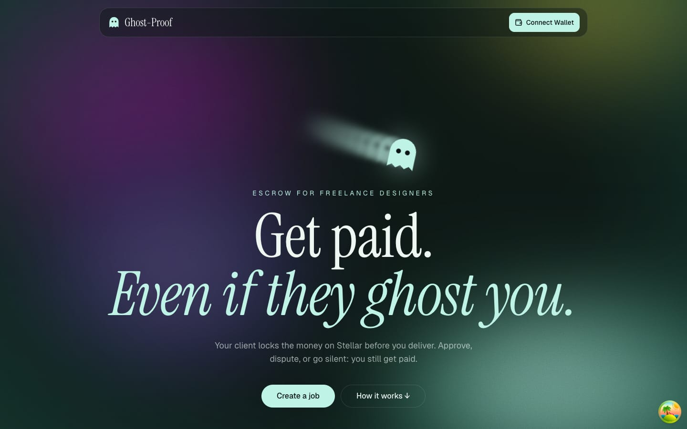
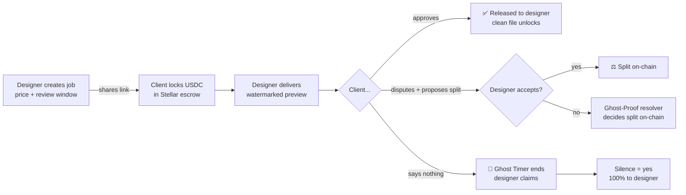
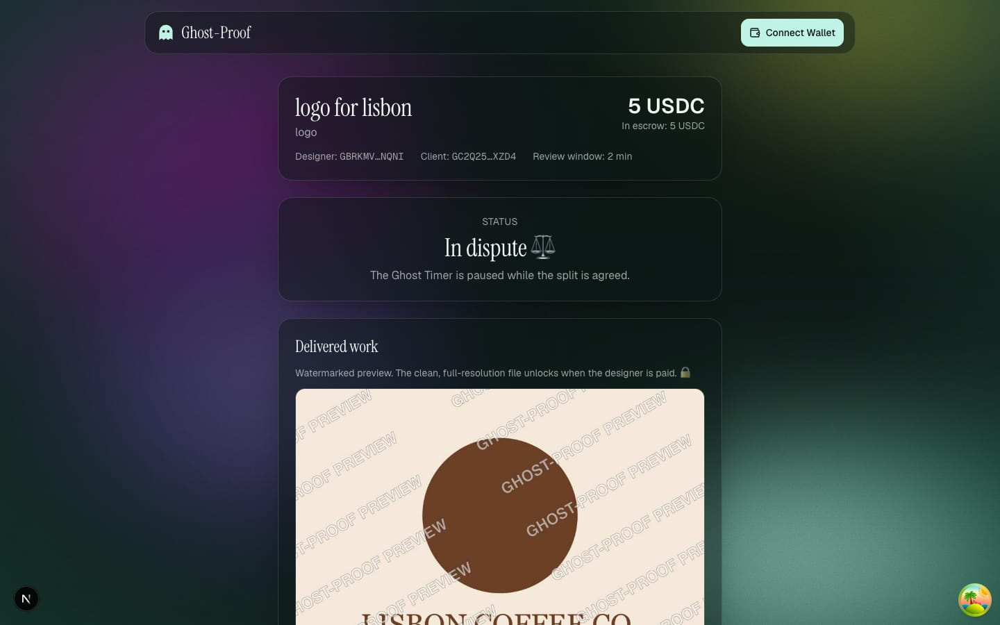
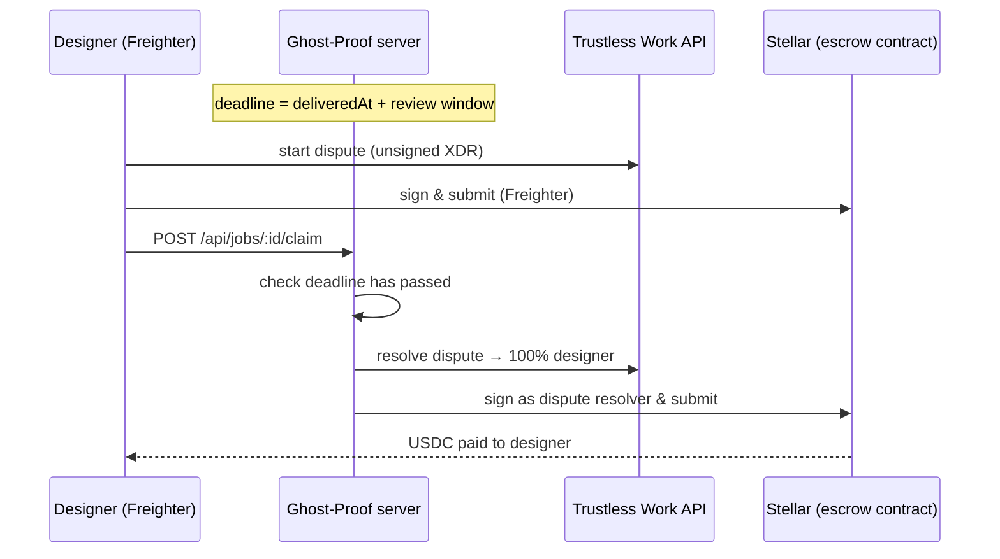

# 👻 Ghost-Proof

**Get paid. Even if they ghost you.**

Ghost-Proof protects freelance designers from being ghosted after they deliver. The client locks the payment in a **Stellar escrow (USDC)** *before* the designer hands over the work. Then there are only three ways it can end, and all of them are fair:

| Outcome | What happens |
|---|---|
| ✅ **Approve** | Client approves → escrow releases to the designer → clean full-res file unlocks |
| ⚖️ **Dispute** | Client writes one sentence and proposes a split → designer accepts, or Ghost-Proof decides |
| 👻 **Ghost** | Client stays silent → the **Ghost Timer** runs out → *silence = yes* → designer claims 100% |

Built at **HackMeridian 2026** (Lisbon) · Genesis path · **Stellar Composed** track
(Trustless Work escrow + USDC + Stellar wallets)



---

## The problem

A designer sends the final files. The client goes quiet. The invoice sits unpaid forever.
Small jobs aren't worth a lawyer, so freelancers chase, wait, and eventually give up. Freelance marketplaces offer escrow, but only inside their platform and for a cut of every job.

**Ghost-Proof makes ghosting pointless:** the money is already locked before the work is handed over, and there is a deadline after which silence counts as approval.

## How it works



1. **Create:** the designer connects Freighter, sets the title, price (USDC) and review window, and gets a shareable link.
2. **Lock:** the client opens the link and clicks *Lock payment*. The Ghost-Proof server deploys a Trustless Work single-release escrow (signed by the platform wallet), then the client signs the funding transaction from their own wallet.
3. **Deliver:** the designer drags in the final image. The server stores the original and generates a **low-res, watermarked preview** (`sharp`). The milestone is marked *Delivered* on-chain, and the **Ghost Timer starts**.
4. **Outcome:**
   - **Approve & pay:** the client signs *approve milestone*, then *release funds*. The full-res file unlocks.
   - **Dispute:** the client signs *start dispute* with a one-line reason and a proposed split. This pauses the Ghost Timer. The designer accepts, or escalates to the Ghost-Proof dispute desk (`/resolver`).
   - **Ghost Timer:** when the window ends without a response, the designer clicks **Claim**. They sign *start dispute*, and the server (the escrow's dispute resolver) checks the deadline really passed, then resolves **100% to the designer**.
5. **Proof:** every job page lists each step with a link to the transaction on [Stellar Expert](https://stellar.expert/explorer/testnet).



## How Stellar and Trustless Work are used

Ghost-Proof doesn't write its own smart contract. It **composes** existing Stellar building blocks:

- **[Trustless Work](https://docs.trustlesswork.com)** single-release escrow (Soroban contract), via the REST API, the `@trustless-work/escrow` React SDK and the `@trustless-work/blocks` UI kit.
- **USDC on Stellar** (testnet, issuer `GBBD47…LFLA5`) as the payment asset.
- **Freighter** wallet (via Stellar Wallets Kit). Wallet address = identity: no accounts, no passwords.
- **Stellar SDK** on the server to sign as the platform / dispute resolver.

### Escrow roles

| Trustless Work role | Ghost-Proof | Why |
|---|---|---|
| Service Provider | Designer | Marks the milestone as delivered, can start a dispute |
| Receiver | Designer | Receives the payment |
| Approver | Client | Approves the delivered work, can start a dispute |
| Release Signer | Client | Releases funds after approving (approve & pay) |
| Dispute Resolver | Ghost-Proof platform wallet | Settles disputes and executes the Ghost Timer payout |
| Platform Address | Ghost-Proof platform wallet | Platform fee set to 0 for the demo |

### Why the Ghost Timer goes through a dispute

Trustless Work escrows have no built-in timeout, and a release signer can only release funds **after approval**. So the only role that can move money without the client is the **dispute resolver**. The Ghost Timer therefore works like this:



The client is protected too: they can approve or dispute at any time during the window, and opening a dispute pauses the timer.

## Run it locally

You need **Node 20+**, the **[Freighter](https://freighter.app)** browser extension (set to **Test Net**), and a **Trustless Work API key** from [dapp.trustlesswork.com](https://dapp.trustlesswork.com).

```bash
git clone https://github.com/siwakadrianna-byte/ghost-proof.git
cd ghost-proof
npm install

# 1. Settings
cp .env.example .env.local
#    → paste your Trustless Work API key into NEXT_PUBLIC_API_KEY

# 2. Create the platform wallet (funded with testnet XLM + USDC trustline)
node scripts/create-platform-wallet.mjs
#    → copy the PLATFORM_SECRET_KEY line into .env.local

# 3. Start
npm run dev
```

Open http://localhost:3000.

**Test wallets:** in Freighter, create two accounts (Designer and Client), fund each with **Friendbot**, add the **USDC** trustline (issuer `GBBD47IF6LWK7P7MDEVSCWR7DPUWV3NY3DTQEVFL4NAT4AQH3ZLLFLA5`), and get test USDC for the client at [faucet.circle.com](https://faucet.circle.com) (Stellar Testnet). The app follows whichever account is active in Freighter, so you can play both sides in one browser.

**Demo tip:** set the review window to **2 minutes** to see the Ghost Timer end during a demo. The dispute desk is at `/resolver` (passcode from `RESOLVER_PASSCODE`).

## Project structure

```
app/
  page.tsx                  Scroll-animated landing page
  new/page.tsx              Create a job (designer)
  job/[id]/page.tsx         Job page: status, Ghost Timer, role-aware actions, on-chain proof
  resolver/page.tsx         Ghost-Proof dispute desk
  api/jobs/...              Job store, escrow deploy, upload/preview/download, dispute, Ghost Timer claim
  api/resolver/route.ts     Resolver decisions
components/ghost/           Ghost-Proof UI (actions hook, aurora background, ghost trail, scroll helpers)
components/tw-blocks/       Trustless Work Blocks (wallet kit, providers, escrow blocks)
lib/
  trustless-server.ts       Server-side Trustless Work calls, signed with the platform wallet
  resolve.ts                Settles a dispute with a designer/client split
  files.ts                  Watermarked previews (sharp) and file unlocking rules
  jobs.ts                   Simple JSON job store (data/jobs.json)
scripts/create-platform-wallet.mjs
```

## Built during the hackathon

Everything in this repo was built on 25–26 October 2026 at HackMeridian (see the commit history):

- Next.js app wired to Trustless Work Blocks, the React SDK and Freighter, plus fixes to make the Blocks work with the latest Next.js / shadcn / zod
- Full escrow lifecycle on Stellar testnet: deploy → fund → deliver → approve → release
- Ghost-Proof flow: create job, shareable client link, role-aware job page with live countdown
- **Ghost Timer:** deadline tracking, designer claim, automatic resolution by the platform resolver
- File delivery with watermarked previews and pay-to-unlock full-resolution downloads
- Disputes: one-sentence reason, proposed split, designer accept/escalate, resolver dispute desk
- Scroll-animated landing page and aurora visual identity

## Honest limitations (MVP)

- **Testnet only.** No real money.
- Jobs and files are stored locally (`data/`), so it runs on one machine for the demo.
- Off-chain job status mirrors on-chain events reported by the browser. The escrow contract is always the source of truth for where the money is.
- The resolver desk uses a simple passcode, not a real admin login.
- Trustless Work charges a small protocol fee (0.3%), so the designer receives slightly less than the job price.

## What's next

- Reputation: on-chain history of paid jobs for designers ("never ghosted" badge)
- Milestones with multi-release escrows for bigger projects
- Email / Telegram notifications when the Ghost Timer is about to end
- Card on-ramp so clients without crypto can pay (Stellar anchors)
- Shared, auditable resolver panel, and mainnet launch

---

Made with ☕ and 👻 in Lisbon for HackMeridian 2026.
